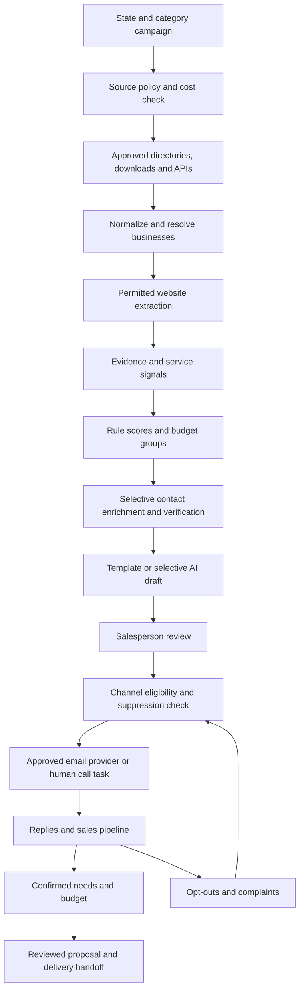

# 04 · Architecture and workflow

## Workload-first design

Use a web dashboard for review and sales work, background workers for collection and enrichment, and durable state for scheduling and outreach. Long-running browsers do not belong in a dashboard HTTP request. Most jobs are deterministic; this is not an AI agent that continuously browses the internet.



## Proposed stack

| Layer | Choice | Purpose |
| --- | --- | --- |
| Dashboard and internal API | Next.js with TypeScript | Filters, account detail, evidence review, campaigns, pipeline |
| Data | PostgreSQL | Business identity, relationships, evidence, sales state, audit and suppression |
| Queue | BullMQ with Redis, initially | Bounded jobs, delays, retries, separate worker pools |
| Static extraction | Node.js fetch + Cheerio | Low-cost HTML and structured-data parsing |
| Browser fallback | Playwright in isolated containers | Permitted dynamic pages and evidence screenshots |
| Evidence files | Private object storage or private local development storage | Short-lived allowed excerpts, imports, screenshots |
| AI | Replaceable structured-output model adapter | Selected summaries and draft wording |
| Messaging | Replaceable provider adapter | Provider-authorized send, inbound replies, delivery events |
| Development | Docker Compose for database, queue, web, worker | Reproducible local environment |

Use a maintained Node.js runtime and pin compatible package versions at implementation time. Keep hosting independent: a small managed server can run the initial stack, or web/API and container workers can use separate managed services. Select a deployment provider after workloads and resource measurements are known.

Technical references: [Next.js](https://nextjs.org/docs), [BullMQ](https://docs.bullmq.io/), [Cheerio](https://cheerio.js.org/docs/intro/), and [Playwright](https://playwright.dev/docs/intro). Provider-specific credentials, API contracts, and model pricing remain implementation decisions.

## Repository structure to create during implementation

```text
apps/web/                       dashboard and internal API
apps/worker/                    collection, enrichment, scheduling
packages/domain/                entities, eligibility rules, scoring
packages/connectors/            policy-aware source adapters
packages/connectors/directories/ listing, membership and local directory adapters
packages/extraction/            HTML parsing and bounded browser logic
packages/messaging/             sender and inbound event adapters
packages/ai/                    typed prompts, validators, usage limits
packages/db/                    schema, migrations, queries
config/industries/              taxonomy and offer mappings
config/sources/                 reviewed source configuration
config/scoring/                 versioned score and budget rules
templates/email/                reviewed message templates
templates/proposals/            discovery-based proposal sections
tests/fixtures/                 synthetic and permitted captured examples
tests/integration/              queue, suppression, provider contracts
infra/                         development and deployment configuration
docs/                          these plans and future operating guides
```

## Job contracts

Each job includes workspace, run, account/source IDs, policy version, idempotency key, cost reservation, attempt count, timeout, and cursor where relevant. Queue payloads hold IDs, not full personal records or API credentials.

Directory connectors expose separate discovery-page and listing-detail steps, plus the business-owned website handoff. They support approved APIs/exports or bounded HTML/browser traversal, source-specific field mappings, pagination caps and incremental refresh. Source policy chooses the access method; a shared directory template never grants permission across every publisher using that template.

Queues: `discovery`, `normalization`, `site-fetch`, `browser-render`, `contact-enrichment`, `verification`, `ai-draft`, `send-dispatch`, `inbound-events`, and `refresh`. Give inbound events and opt-outs priority over discovery.

Persist business state in PostgreSQL. Use a transactional outbox to publish queue events after database commits. Workers acknowledge only after durable results are stored. Retry temporary read failures with exponential backoff and bounded attempts. Policy denial, invalid input, expired permission, and unsafe URLs are terminal failures requiring review, not automatic retries.

An account can be ready for research while one contact is ineligible for email. Do not overload a single “lead status” to control all channels.

## Sending workflow

```text
draft -> reviewed -> scheduled -> dispatching
dispatching -> accepted | failed | reconciliation_needed
accepted -> delivery_events / reply / bounce / complaint
```

Immediately before an external send, re-check the reviewed content hash, source usage rights, applicable channel rules, current verification, account/contact suppression, campaign state, recipient time window, mailbox health, and total touch limits. Use contact/account dispatch locks to serialize enrollment and stop operations. No earlier “approved” state bypasses this check.

Create a unique dispatch key from workspace, contact, campaign, step, and draft version. Use provider idempotency only where documented. A timeout after submission can mean the provider already accepted the email: mark it for reconciliation using provider IDs or supported lookup tags. If acceptance cannot be established, require review rather than blindly sending again. The design provides deduplication and reconciliation; it does not assume exactly-once external delivery.

Opt-outs cancel queued steps, update the central suppression registry, and pause related account activity when the request concerns the business. A dispatch already accepted by an external provider cannot be recalled reliably; log timing and minimize the race with final checks and locking.

## Reply handling

Prefer native provider events or an approved inbound mailbox integration. Authenticate webhooks, deduplicate events, preserve provider timestamps, and process out-of-order delivery safely. Poll incrementally as a recovery path where supported.

Any reply immediately pauses follow-ups. Deterministic rules handle obvious opt-outs, bounces, and out-of-office notices; AI may suggest a classification of other replies. A salesperson decides the next response, meeting, or proposal. An out-of-office reply must not trigger an automatic sales reply loop. Missing or delayed inbound synchronization pauses dispatch rather than risking follow-ups after a reply.

## Security and reliability requirements

- Authenticate every dashboard/API action; use owner, researcher, and salesperson roles. Audit exports, review decisions, policy changes, and sends.
- Keep mailbox tokens and API keys encrypted in a secret store. Redact them from logs and AI payloads.
- Enforce outbound network controls against SSRF for HTTP fetches and all browser subresources. Block private, loopback, link-local, metadata, and non-HTTP(S) targets; revalidate DNS resolution and every redirect; restrict ports and downloads.
- Run browser workers without internal-network access or shared authenticated browser profiles. Treat remote text and files as untrusted.
- Separate test and production credentials and recipients. Default to a fake sender until launch gates pass.
- Apply limits to file size, decompression, URLs, redirects, memory, browser execution, request volume, and paid API calls.
- Use database uniqueness constraints plus idempotent handlers. Back up data daily and test restoration before outreach launch.
- Provide a global outreach stop switch, per-campaign pause, per-source pause, and per-provider spending stop.

Start as one internal agency workspace, while including `workspace_id` in access control and uniqueness keys to avoid future data leakage if more workspaces are added.
